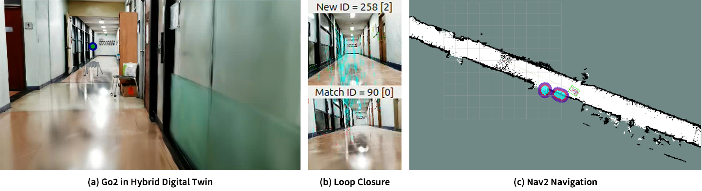
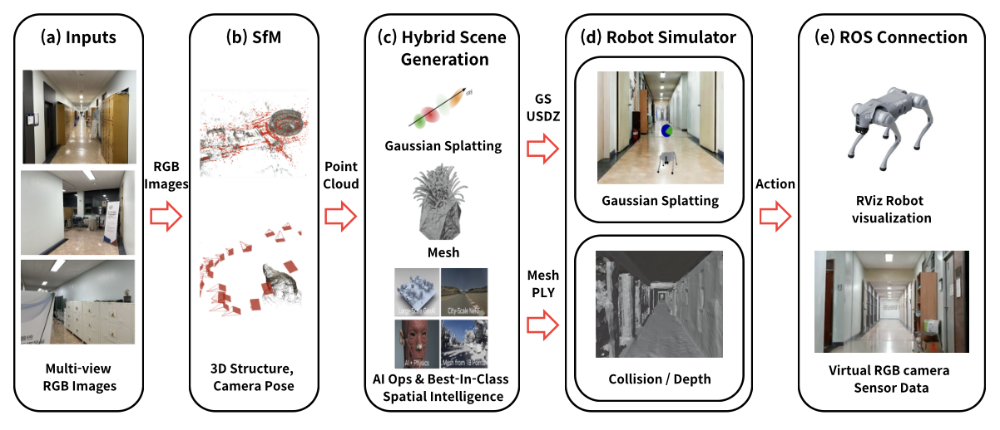
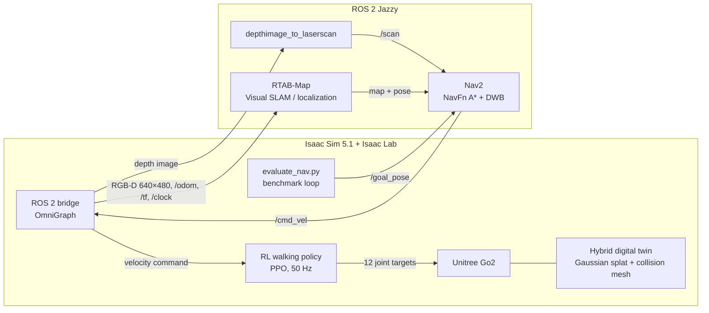

# Go2 Navigation in a 3D Gaussian Splatting Digital Twin

**A photoreal, physics-enabled digital twin of a real university corridor, built from ordinary camera photos, used to test an unmodified ROS 2 navigation stack (RTAB-Map Visual SLAM + Nav2) on a simulated Unitree Go2 robot dog. The Go2 reached its goal in 55 of 60 autonomous runs (91.7%).**


📄 **Paper:** J.-H. Won, S.-Y. Park, S.-S. Hwang, *"A Visual-Physical Hybrid Digital Twin Simulation Environment Based on 3D Gaussian Splatting for Validation of Vision-Based Autonomous Navigation Algorithms,"* Journal of Institute of Control, Robotics and Systems (ICROS), 2026. I'm the first author and was the team lead.

<p align="center">
  
  <br>
  <em>(a) The Go2 walking to its goal in the hybrid digital twin. (b) An RTAB-Map loop closure: visual features matched between the current and an earlier keyframe. (c) The robot and its planned path on the Nav2 occupancy grid.</em>
</p>

## Why this exists

Testing vision-based robots in the real world is slow and risky, and it's hard to repeat an experiment under the same conditions. Simulators fix that, but the usual options each fall short:

- **CAD or mesh scenes** are good for physics but look nothing like the real place. Feature-based SLAM behaves differently on clean, uniform textures than on real walls.
- **3D Gaussian Splatting (3DGS)** reproduces a real space photorealistically from camera images and renders in real time, but it has no surfaces to collide with.
- **Accurate scans** usually need expensive LiDAR.

This project combines both representations of the same space, aligned in one coordinate frame. **The Gaussian splat is what the robot's camera sees; a mesh extracted from it is what the robot walks on, collides with, and measures depth from.** A two-way ROS 2 bridge lets the same SLAM and navigation software used on real robots run in the simulator unchanged. Related 3DGS simulators (SplatSim, RoboGSim, Vid2Sim, GaussGym) focus on generating training data or learning policies. This one plugs in a standard ROS 2 SLAM and navigation stack.

## How it works

<p align="center">
  
  <br>
  <em>(a) Photos of the corridor, (b) camera poses and a sparse point cloud from Structure-from-Motion, (c) a Gaussian splat for visuals plus a surface mesh extracted with NVIDIA fVDB, (d) both layers combined in Isaac Sim, (e) virtual sensor data exchanged with ROS 2.</em>
</p>

At runtime the simulator and the ROS 2 navigation stack form a closed loop:



RTAB-Map localizes from RGB images rendered off the Gaussian splat, while the depth images that feed the Nav2 costmaps come from the mesh. The visual layer drives localization; the physical layer drives obstacle avoidance and contact. A PPO walking policy turns Nav2's velocity commands into the Go2's 12 joint targets.

| | |
|---|---|
| **Input** | 2,791 photos (6192 × 4128) from a regular RGB camera, no LiDAR |
| **Visual layer** | 3D Gaussian Splatting, ~530k Gaussians (4,000 iterations, ~12 h) |
| **Physical layer** | ~400k-triangle mesh from NVIDIA fVDB sparse-volume surface reconstruction |
| **Simulation** | Isaac Sim 5.1 + ROS 2 Jazzy, RGB-D camera 640 × 480 at 50 Hz, physics at 200 Hz |
| **Go2 walking policy** | PPO in Isaac Lab, 4,096 parallel robots, 8,000 iterations (~12 h), 50 Hz inference |
| **Hardware** | Intel Core i9-9900K, NVIDIA RTX 5070 Ti, 64 GB RAM, Ubuntu 24.04 |

## My role

First author of the paper and team lead. I coordinated the project and owned three parts of it:

- **Digital-twin scene.** Brought the reconstruction into Isaac Sim: aligning the Gaussian splat and the mesh, setting up collisions, calibrating scale against the robot, and tuning spawn poses.
- **ROS 2, SLAM and Nav2 integration.** The sensor bridge between Isaac Sim and ROS 2, the RTAB-Map mapping and localization workflow, and Nav2 configuration, including retuning the costmaps for the narrow corridor.
- **Evaluation and paper.** Built the automated navigation benchmark, debugged the full pipeline end to end (see [Problems solved](#problems-solved)), and led the paper.

The Go2 walking policy was trained by other team members.

## Results

**Repeated autonomous navigation with the Go2** (paper, Table 3). Two goals in the corridor, a short one (G1) and a long one (G2), 30 runs each from the same start pose. A run succeeds if the robot ends within 0.5 m of the goal within 30 s.

| Goal | Straight-line distance | Success | Mean time to goal |
|---|---|---|---|
| G1 | 5 m | 28 / 30 (93.3%) | 6.2 s |
| G2 | 15 m | 27 / 30 (90.0%) | 18.9 s |
| **All** | | **55 / 60 (91.7%)** | **12.4 s** |

A walking robot's camera bobs with every step, a harder viewpoint condition than a wheeled robot's, yet success stayed above 90% at both distances. This shows the 3DGS renders hold up as Visual SLAM input under that motion, and the mesh handles foot contact reliably. In the corridor, which is repetitive and hard for Visual SLAM, RTAB-Map still recognized the walls, doors and fixtures and closed loops (figure above). The paper also ran the same digital twin and navigation stack on a wheeled differential-drive robot without changes.

**Reproducing these numbers.** The paper's runs used an updated setup on a second workstation: the 8,000-iteration policy exported to TorchScript, and two goals from a shared start. The scripts in this repository come from the original workstation, and `evaluate_nav.py` still lists the routes of an earlier benchmark there.

## Problems solved

The most instructive bugs fixed along the way:

- **A robot that silently ran on random weights.** The robot accepted keyboard commands but its legs never moved. A launcher typo (`+checkpoint` instead of `--checkpoint`) made the script fall back to an incompatible checkpoint, and `load_state_dict(strict=False)` loaded 0 tensors without complaint. Fixed with an explicit key mapping from the skrl checkpoint to the network, plus `strict=True` so a mismatch now fails loudly.
- **Two Pythons, one ROS graph.** Isaac Sim bundles Python 3.11 while ROS 2 Jazzy uses 3.12, and the system ROS 2 environment leaking into Isaac Sim crashed `rclpy` with ABI and typesupport errors. The launchers now strip the system ROS variables and point Isaac Sim at its bundled ROS 2 bridge; the two sides talk over DDS.
- **A corridor narrower than the costmap.** Success was low no matter which goals were picked. A distance transform on the occupancy grid showed the corridor is at most 1.6 m wide, with a median clearance of 0.55 m along the driven path, while Nav2's 0.6 m inflation radius covered almost all of it. Reducing it to 0.35 m opened a usable driving lane.
- **Goals that never arrived.** The benchmark published each Nav2 goal once, with volatile QoS, sometimes before Nav2 was subscribed, so the goal was lost and the robot stood still. Goals are now republished at the start of every run.
- **Headless-mode gaps.** Camera render products can't be created in headless mode without `--enable_cameras`, and one OmniGraph node type the code used doesn't exist in Isaac Sim 5.1, so the goal publisher was rewritten with plain `rclpy`.

## What's in this repository

The paper's system has two halves: building the digital twin (photos → SfM → Gaussian splat + mesh → Isaac Sim scene) and running robots in it. This repository is the **Go2 navigation half**: the Isaac Lab task that loads the hybrid scene, the ROS 2 sensor bridge, keyboard and Nav2 control, the automated benchmark, and the RTAB-Map / Nav2 launchers and configuration. The reconstruction pipeline and the wheeled-robot setup are not included, and neither are the scene, map and trained checkpoints (lab data, about 530 MB).

```
├── install.sh              # copies isaaclab_overrides/ into an Isaac Lab checkout
├── isaaclab_overrides/     # Python that runs inside Isaac Lab
│   ├── flat_env_cfg.py     #   Go2 task config: hybrid scene, spawn, episode length
│   ├── play.py             #   interactive sim: WASD driving + Nav2 /cmd_vel
│   ├── evaluate_nav.py     #   automated Nav2 benchmark (writes eval_results.csv)
│   └── ros2_sensor_setup.py  # OmniGraph ROS 2 bridge: camera, odom, TF, clock, /cmd_vel
├── scripts/                # launchers (all paths configured in scripts/env.sh)
├── config/nav2_params.yaml # Nav2 planner, controller and costmap settings
├── docs/images/            # figures
└── assets/                 # lab scene, map and checkpoints go here (not in git)
```

## Running it

### Requirements

- Ubuntu 24.04 with an NVIDIA RTX GPU (developed on an RTX 5070 Ti)
- [NVIDIA Isaac Sim 5.1.0](https://docs.isaacsim.omniverse.nvidia.com/) (standalone install)
- [ROS 2 Jazzy](https://docs.ros.org/en/jazzy/) with Nav2, RTAB-Map and depthimage_to_laserscan
- The lab's Isaac Lab fork, [CGV-HGU/isaac-go2-ros2](https://github.com/CGV-HGU/isaac-go2-ros2), branch `simul-trio`
- The scene, map and checkpoints from the lab; see [`assets/README.md`](assets/README.md) for the expected layout

### Setup

```bash
# 1. Isaac Lab fork (Go2 task, ROS 2 bridge support)
git clone -b simul-trio https://github.com/CGV-HGU/isaac-go2-ros2.git ~/IsaacLab
cd ~/IsaacLab
ln -s /path/to/isaac-sim _isaac_sim
./isaaclab.sh --install

# 2. ROS 2 packages
sudo apt install ros-jazzy-navigation2 ros-jazzy-nav2-bringup \
    ros-jazzy-rtabmap-ros ros-jazzy-depthimage-to-laserscan

# 3. This repository: clone it, then from its root
./install.sh
```

Then put the lab assets under `assets/` as described in [`assets/README.md`](assets/README.md).

### Usage

Run each command in its own terminal, from this repository's root.

**Drive the robot and build a map**

```bash
./scripts/play.sh                  # Isaac Sim; click the viewport, drive with WASD, Q/E to turn
./scripts/backup_maps.sh           # optional: keep the current map
./scripts/rtabmap_mapping.sh       # RTAB-Map mapping (starts a new map)
./scripts/save_2d_map.sh           # when done driving, before stopping mapping
```

**Navigate to goals you click in RViz**

```bash
./scripts/play.sh
./scripts/rtabmap_localization.sh  # map + RTAB-Map localization + Nav2 + RViz
```

In RViz, set the robot's position with **2D Pose Estimate**, then send a **Nav2 Goal**. Pressing a WASD key overrides Nav2 while it's held.

**Run the benchmark**

```bash
./scripts/evaluate_nav.sh          # starts its own Isaac Sim; don't run play.sh alongside
./scripts/rtabmap_localization.sh
```

Results are appended to `eval_results.csv` in the Isaac Lab folder as each run finishes. Each benchmark starts a new file, so copy it elsewhere before rerunning.

### Configuration

Every path is set in [`scripts/env.sh`](scripts/env.sh) and can be overridden by exporting the variable first:

| Variable | Default | What it is |
|---|---|---|
| `ISAACLAB_DIR` | `~/IsaacLab` | Isaac Lab checkout |
| `ISAAC_SIM_ROOT` | `$ISAACLAB_DIR/_isaac_sim` | Isaac Sim install |
| `ASSETS_DIR` | `<repo>/assets` | Lab assets root |
| `GO2_SCENE_USD` | `$ASSETS_DIR/scene/05_08_real(original).usd` | Main scene file |
| `MAP_DIR` | `$ASSETS_DIR/map` | RTAB-Map database and 2D map |
| `SKRL_CHECKPOINT` | `$ASSETS_DIR/checkpoints/skrl_…/best_agent.pt` | Policy for `play.sh` |
| `RSL_RL_CHECKPOINT` | `$ASSETS_DIR/checkpoints/rsl_rl_…/model_1999.pt` | Policy for `evaluate_nav.sh` |
| `NAV2_PARAMS` | `config/nav2_params.yaml` | Nav2 settings |

## Known limitations

From the paper:

- **3DGS rendering artifacts.** Areas that were sparsely photographed, or viewed from far outside the capture path, can render blurry or with floaters, which can hurt feature extraction and loop closure.
- **The two layers can disagree.** RGB comes from the Gaussian splat and depth from the mesh, so where surface reconstruction is poor, such as glass doors and reflective surfaces, the camera image and depth image don't match.
- **Static scenes only.** No pedestrians or moving obstacles yet.

In this code:

- **The benchmark's G1/G2 coordinates aren't here yet**; `evaluate_nav.py` has the earlier run's routes (see [Results](#results)).
- **Success only checks position** (within 0.5 m), not heading. Failures are only classified as timeout or fall/collision.
- **The random-obstacle code is inactive.** `play.py` and `evaluate_nav.py` place a "Drawer" obstacle each run, but the scene contains no Drawer.
- **The benchmark runs with the GUI open.** In headless mode the sensor topics didn't reliably reach ROS 2 subscribers, and the cause was never pinned down.
- **The scene's scale (0.459×) was calibrated by eye** against the robot, since a camera-only reconstruction has no inherent metric scale.
- Isaac Sim's camera graph also publishes a depth *image* on `/scan`, the same topic `depthimage_to_laserscan` uses for its `LaserScan`.

## Citation

```bibtex
@article{won2026hybrid,
  title   = {A Visual-Physical Hybrid Digital Twin Simulation Environment Based on 3D Gaussian Splatting for Validation of Vision-Based Autonomous Navigation Algorithms},
  author  = {Won, Jong-Hun and Park, Seo-Youn and Hwang, Sung-Soo},
  journal = {Journal of Institute of Control, Robotics and Systems},
  year    = {2026}
}
```

## Acknowledgements

Built at the [Computer Graphics and Vision Lab (CGV Lab)](https://cgv-hgu.github.io), Handong Global University, with co-author Seo-Youn Park and advisor Prof. Sung-Soo Hwang. This research was supported by the ANCHOR program Glocal University 30 through the Gyeongbuk ANCHOR CENTER, funded by the Ministry of Education (MOE) and Gyeongsangbuk-do, Republic of Korea (2026-ANCHOR-15-119).

Uses [Isaac Lab](https://github.com/isaac-sim/IsaacLab), [NVIDIA Isaac Sim](https://developer.nvidia.com/isaac/sim), [NVIDIA fVDB](https://github.com/openvdb/fvdb-core), [RTAB-Map](https://github.com/introlab/rtabmap_ros) and [Nav2](https://github.com/ros-navigation/navigation2).

## License

Code: [MIT](LICENSE). `play.py`, `evaluate_nav.py` and `flat_env_cfg.py` in `isaaclab_overrides/` are modified from Isaac Lab and keep their original BSD-3-Clause headers. Figures are reproduced from the paper (© ICROS 2026). The scene, map and checkpoints belong to CGV Lab and are not covered by this license.
